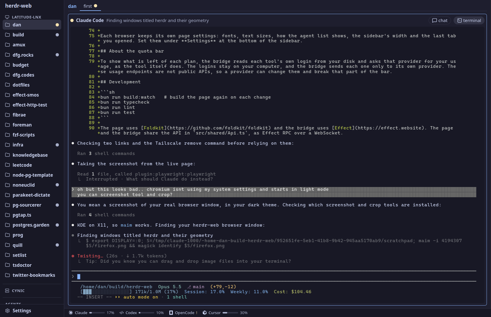

# herdr-web

A browser view of your [herdr](https://github.com/herdrdev/herdr-app) terminals, for a desk or a phone.



It shows the spaces, tabs and panes of your herdr-app window, live:

- Type into any terminal, or read a Claude Code agent's conversation as a chat and answer it.
- Answer an agent's permission prompts and questions from its chat: tap a choice, or type its number.
- See which agents are working, waiting for you, or done, and for how long, in the sidebar and the tabs.
- Open any space, tab, pane or setting by name: press Ctrl+K (Cmd+K on a Mac).
- Split and close panes, and drag spaces into a new order. herdr-app makes the change, so the window shows it too.
- Check how much of your Claude, Codex, Cursor and OpenCode plans is left, in the bar at the bottom.
- On a phone, the sidebar is a drawer, and a row of soft keys gives you Esc, Tab, Ctrl, the arrows and more.

herdr-web is a bridge, a small Bun server on the computer that runs herdr. The page talks to the bridge, and the bridge talks to herdr-core and herdr-app.

## Requirements

- [Bun](https://bun.sh) 1.4 or later.
- [herdr-app](https://github.com/herdrdev/herdr-app) and [herdr-core](https://github.com/herdrdev/herdr-core), running on the same computer. The herdr-app installer also installs herdr-core.
- Linux. The bridge finds herdr-core's socket in `$XDG_RUNTIME_DIR`.
- Optional: fontconfig (`fc-list`), so that a phone can use the desktop's fonts.

## Setup

```sh
git clone https://github.com/DanielFGray/herdr-web
cd herdr-web
bun install
bun run build
bun run start
```

Open http://127.0.0.1:4180.

`bun run build` builds the page into `dist/`, and the bridge serves it from there. Build again after you change the page.

## Use it from your phone with Tailscale

The bridge listens only on `127.0.0.1`. There is no login, and the bridge can type into your shells, so do not put it on a network that other people use. [Tailscale](https://tailscale.com) gives your own devices a private way in.

1. Let Tailscale serve the bridge over HTTPS to your tailnet only:

   ```sh
   tailscale serve --bg --https=8443 http://127.0.0.1:4180
   ```

   `tailscale serve status` shows the address, such as `https://my-computer.my-tailnet.ts.net:8443`.

2. Start the bridge, and tell it to accept that name:

   ```sh
   HERDR_WEB_HOSTS=my-computer.my-tailnet.ts.net:8443 bun run start
   ```

   The bridge refuses a request that names a host it does not know. This stops a web page from reaching it through DNS rebinding, a trick where a page gets a request sent to your computer under the page's own name.

3. Open `https://my-computer.my-tailnet.ts.net:8443` on any device on your tailnet.

`tailscale serve --bg` keeps the rule after a reboot. To remove it, run `tailscale serve --https=8443 off`.

## Settings

The bridge reads these environment variables:

| Variable | Default | Use |
| --- | --- | --- |
| `HERDR_WEB_PORT` | `4180` | The port the bridge listens on. |
| `HOST` | `127.0.0.1` | The address the bridge listens on. Anything other than loopback opens it to that network. |
| `HERDR_WEB_HOSTS` | none | More host names a request may use, separated by commas, each with its port, such as a Tailscale name. |
| `HERDR_APP_HOME` | `~/.config/herdr-app` | Where herdr-app keeps its command socket. |
| `CLAUDE_CONFIG_DIR` | `~/.claude` | Where Claude Code keeps its conversations and login. |
| `CODEX_HOME` | `~/.codex` | Where Codex keeps its login. |

Each browser keeps its own page settings: fonts, text sizes, how the agent list shows, the sidebar's width and the last tab you opened. Set them under **Settings** at the bottom of the sidebar.

## About the quota bar

To show what is left of each plan, the bridge reads each tool's own login from your disk and asks that provider for your usage, as the tool itself does. The logins stay on your computer, and the bridge sends each one only to its own provider. These usage endpoints are not public APIs, so a provider can change them and break that part of the bar.

## Development

```sh
bun run build:watch   # build the page again on each change
bun run typecheck
bun run lint
bun run test
```

The page uses [Foldkit](https://github.com/foldkit/foldkit) and the bridge uses [Effect](https://effect.website). The page and the bridge share the API in `src/shared/Api.ts`, as Effect RPC over a WebSocket.
